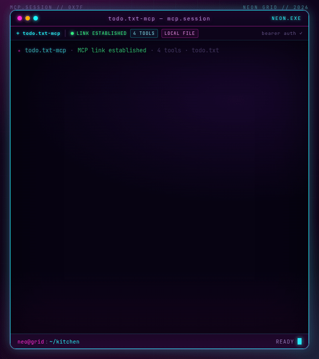
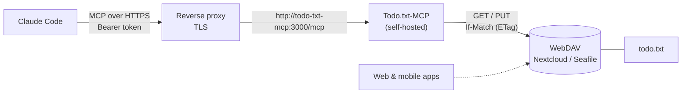
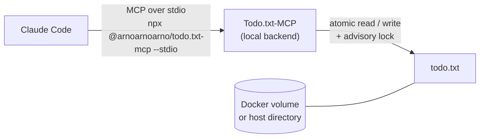

# Todo.txt-MCP

Todo.txt-MCP is a [Model Context Protocol](https://modelcontextprotocol.io)
(MCP) server for managing a `todo.txt` file. It lets AI agents list, add, edit,
and complete tasks. Todos can be stored in a local file or synchronized over
WebDAV.

<p align="center">
  
  <br>
  <sub>An MCP client checks the list, adds the missing pancake ingredients, and verifies the result.</sub>
</p>

The server runs on **Node.js 26 LTS** and executes TypeScript directly using
Node's built-in type stripping, so there is no build step. The minimum supported
runtime is Node.js 24.15.

## 🗺️ How it works

Claude Code (or any MCP client) either launches Todo.txt-MCP as a local
subprocess over stdio, or connects to a self-hosted instance over HTTP. The
server owns the todo file; the only difference between the setups is where that
file lives.

### WebDAV backend: sync with Nextcloud or Seafile

The container keeps the todo file on your existing WebDAV storage, so the same
list is available to Claude Code, the Nextcloud/Seafile web UI, and mobile apps.



### Local file backend: keep everything on one host

With `TODOTXT_MCP_BACKEND=local` the file never leaves the machine or Docker
volume. The client can launch the server directly as a subprocess over stdio
(the simplest option for local use), or connect over HTTP when the server is
shared.



The same server still runs over HTTP for shared or containerized deployments;
stdio is simply the shortest path when the client and file are on one host.

## 📦 Quick Start with npm

Requires Node.js **26 LTS** (minimum 24.15). The package ships the TypeScript
sources and runs them with Node's built-in type stripping, so there is no build
step.

```bash
export MCP_AUTH_TOKEN="$(openssl rand -hex 32)"
npx -y @arnoarnoarno/todo.txt-mcp
```

Or install it globally:

```bash
npm install -g @arnoarnoarno/todo.txt-mcp
todo.txt-mcp
```

The server listens on `http://localhost:3000` and the MCP endpoint is
`http://localhost:3000/mcp`. It reads the same environment variables as the
Docker setup below.

### Run as a local subprocess (stdio)

Clients that can launch a command can run the server directly. No HTTP listener,
port, TLS, or bearer token is involved:

```json
{
  "mcpServers": {
    "todo.txt": {
      "command": "npx",
      "args": ["-y", "@arnoarnoarno/todo.txt-mcp", "--stdio"],
      "env": {
        "TODOTXT_MCP_BACKEND": "local",
        "TODOTXT_MCP_LOCAL_FILENAME": "/home/me/todo.txt"
      }
    }
  }
}
```

`MCP_TRANSPORT=stdio` is equivalent to passing `--stdio`. The WebDAV backend
works the same way; set `TODOTXT_MCP_BACKEND=webdav` and the WebDAV variables.
HTTP remains the default, so `npm start`, Docker, and existing client URLs are
unchanged.

In stdio mode:

- stdout carries MCP protocol messages only; all logs go to stderr.
- `MCP_AUTH_TOKEN`, Host/Origin allowlists, TLS, and metrics do not apply.
- stdin EOF, `SIGINT`, and `SIGTERM` stop the server cleanly. In-flight tool
  calls are allowed to finish so the advisory lock is released, then the process
  exits.

## 🚀 Quick Start with Docker

```yaml
services:
  todo-txt-mcp:
    build: https://github.com/ArnoNuyts/Todo.txt-MCP.git
    ports:
      # Loopback only; put a TLS reverse proxy in front to expose it.
      - "127.0.0.1:3000:3000"
    volumes:
      # Mount a directory so atomic file replacement works.
      - ./data:/data
    environment:
      - HOST=0.0.0.0
      - MCP_ALLOWED_HOSTS=localhost,127.0.0.1
      - MCP_ALLOWED_ORIGINS=http://localhost:3000
      - TODOTXT_MCP_BACKEND=local
      - TODOTXT_MCP_LOCAL_FILENAME=/data/todo.txt
      # Required: the server refuses to start without an auth token.
      - MCP_AUTH_TOKEN=${MCP_AUTH_TOKEN:?set MCP_AUTH_TOKEN}
      # - TODOTXT_MCP_BACKEND=webdav
      # - TODOTXT_MCP_WEBDAV_URL=https://dav.example.com
      # - TODOTXT_MCP_WEBDAV_USERNAME=user
      # - TODOTXT_MCP_WEBDAV_PASSWORD=pass
```

1. **Run**:
   ```bash
   mkdir -p data
   cp todo.txt.example data/todo.txt
   export MCP_AUTH_TOKEN="$(openssl rand -hex 32)"
   docker compose up -d
   ```
2. **Access**: the server listens at `http://localhost:3000`.
3. **MCP endpoint**: `http://localhost:3000/mcp`

Authentication is **required**. The server refuses to start unless
`MCP_AUTH_TOKEN`, `MCP_AUTH_TOKENS`, or `MCP_AUTH_TOKEN_FILE` is set. Clients
must send `Authorization: Bearer <token>`.

> **This quick start is for local use.** It passes `MCP_AUTH_TOKEN` in the
> environment, where it is visible to `docker inspect` and
> `/proc/<pid>/environ`. For a public host use `docker-compose.deploy.yml` with
> a `0600` secret file and the TLS proxy references in
> [`deploy/`](deploy/README.md).

> The container runs as the unprivileged `node` user (UID 1000). If `data/` is
> not writable by that user, adjust its ownership, for example
> `sudo chown -R 1000:1000 data`.

See [SECURITY.md](SECURITY.md) for Host/Origin allowlists, bearer-token auth,
and reverse-proxy TLS guidance.

### Expose it over HTTPS (single user)

```bash
install -d -m 700 secrets
openssl rand -hex 32 > secrets/mcp_auth_token.txt
chmod 600 secrets/mcp_auth_token.txt

cp .env.example .env
# Set the public hostname (and browser origin only if one is used), and change
# the example TRUST_PROXY=false to loopback or the Docker gateway/CIDR:
#   MCP_ALLOWED_HOSTS=todo.example.com
#   MCP_ALLOWED_ORIGINS=https://todo.example.com
#   TRUST_PROXY=loopback   # see the Docker caveat in deploy/README.md

docker compose -f docker-compose.deploy.yml up -d
```

The deploy file mounts the token as a Docker secret and reads it through
`MCP_AUTH_TOKEN_FILE`; it keeps the published port on `127.0.0.1:3000` and adds
log rotation (`max-size: 10m`, `max-file: 3`). Put Caddy or nginx in front with
[`deploy/Caddyfile`](deploy/Caddyfile) or [`deploy/nginx.conf`](deploy/nginx.conf):
TLS, HTTP→HTTPS, HSTS, a 64 KiB body cap, proxy rate limits, and `/metrics`
denied by default.

Follow the full runbook in
[docs/single-user-deployment.md](docs/single-user-deployment.md) and the
backup/restore procedure in [docs/backup-restore.md](docs/backup-restore.md)
before exposing `/mcp` to the internet. Static bearer auth is an API-key gate,
not OAuth 2.1 or MCP discovery.

## 💻 Run Locally

Requirements:

- [Node.js](https://nodejs.org) **26 LTS** (minimum 24.15)
- npm 12

```bash
npm ci
export MCP_AUTH_TOKEN="$(openssl rand -hex 32)"
npm start
```

The default port is `3000`. Override it with the `PORT` environment variable:

```bash
PORT=8080 npm start
```

To serve stdio instead of HTTP from a checkout:

```bash
npm start -- --stdio
```

If you change the port, update `MCP_ALLOWED_ORIGINS` and the MCP client URL
(for example `http://localhost:3330/mcp`) to match. The examples in this repo
assume `3000`.

For development with automatic restarts:

```bash
npm run dev
```

## 🧪 Testing

The test suite uses [Vitest](https://vitest.dev).

```bash
npm test              # run once
npm run test:watch    # watch mode
npm run test:coverage # coverage report
npm run typecheck     # TypeScript type checking
npm run knip          # unused files, exports, types, and dependencies
npm run bench:actions # token cost of add/edit/status/pagination workflows
npm run bench:agent   # LLM usability of the tool surface
```

See [docs/release-flow.md](docs/release-flow.md) for the branch and release
process.

## 🤖 LLM usability evaluation

`bench:actions` measures deterministic protocol cost: the fixed add, edit,
status, and pagination workflow with no model in the loop. `bench:agent` measures
**usability**: it gives a model a set of natural-language multi-item tasks,
exposes the real MCP tools, runs an OpenAI-style function-calling loop, and
grades the resulting `todo.txt` state.

Run the offline harness with a scripted model (no API key required):

```bash
npm run bench:agent -- --mock
```

The mock only proves the harness wiring and graders work; its success rates are
not a model-quality signal. Use a real model for comparisons.

Run against any OpenAI-compatible `/chat/completions` endpoint:

```bash
export AGENT_EVAL_API_KEY="sk-..."
export AGENT_EVAL_MODEL="gpt-4.1-mini"
# Optional: export AGENT_EVAL_BASE_URL="https://api.openai.com/v1"
npm run bench:agent -- --trials 1 --max-turns 12
```

Useful options:

- `--trials 1` — trials per task.
- `--task <id>` — run one task, e.g. `--task stale-hash-recovery`.
- `--max-turns 12` — model turns before the run stops.
- `--json <path>` — write full per-run results and traces as JSON.
- `--mock` — offline scripted model; uses estimated tokens (chars / 4).
- `--model <name>` / `--base-url <url>` — override the environment.

Configuration:

| Variable | Purpose |
|---|---|
| `AGENT_EVAL_API_KEY` | API key; falls back to `OPENAI_API_KEY`. |
| `AGENT_EVAL_BASE_URL` | OpenAI-compatible base URL (default: `https://api.openai.com/v1`). |
| `AGENT_EVAL_MODEL` | Model name; required for a real run. |
| `AGENT_EVAL_TEMPERATURE` | Sampling temperature (default: `0`). |

The table reports success rate (graded from the final todo state, not the
model's prose), average tool calls, invalid tool calls, average turns, average
total tokens (from provider usage), and tokens per successful task. Successful
tool results are text-only; errors may carry a `structuredContent.error` code,
which the harness includes as JSON. The task suite lives in
`bench/agent-tasks.ts`; each task has a seed fixture and a deterministic
`verify` function. Read-only tasks also inspect the final answer, for example
to confirm that a counting request did not modify the file.

## ⚙️ Configuration

Configuration is read from `todo.txt-mcp-config.json` in the working directory
(optional), then overridden by environment variables. See
`todo.txt-mcp-config.example.json`.

### Transport

- `MCP_TRANSPORT`: `http` (default) or `stdio`. The `--stdio` CLI flag takes
  precedence. Invalid values fail startup instead of silently falling back.

### Deployment and security

| Variable | Default | Purpose |
| --- | --- | --- |
| `HOST` | `127.0.0.1` | Bind address. Use `0.0.0.0` only for a container or the private proxy hop. |
| `MCP_ALLOWED_HOSTS` | `localhost,127.0.0.1,[::1]` | Hostnames accepted in `Host`; add the public name. |
| `MCP_ALLOWED_ORIGINS` | `http://localhost:3000` | Browser origins allowed for `POST /mcp`; leave empty to disable CORS. |
| `MCP_AUTH_TOKEN_FILE` | unset | Token file (precedence over env). Reloaded on `SIGHUP`; keep it `0600`. |
| `MCP_ALLOW_WEAK_TOKEN` | unset | Loopback-only escape hatch; refused on a non-loopback `HOST`. |
| `TRUST_PROXY` | `false` | Trust only the real proxy (`loopback` for same-host native, the Docker gateway/CIDR for a published port). |
| `MCP_METRICS_ENABLED` | loopback: on; non-loopback: off | Explicitly enable/disable `GET /metrics` (`1`/`true`/`yes` or `0`/`false`/`no`). |
| `MCP_METRICS_TOKEN` | unset | Separate high-entropy token for `/metrics`; when set, the `/mcp` token is rejected there. |
| `MCP_METRICS_RATE_LIMIT_PER_MIN` | `60` | Separate metrics limiter; `0` disables it. |

### Local File Backend (Default)

Stores todos in a local text file.

- `TODOTXT_MCP_BACKEND`: Set to `local`.
- `TODOTXT_MCP_LOCAL_FILENAME`: Path to the todo file (default: `todo.txt`).

### WebDAV Backend

Syncs todos with a WebDAV server (e.g., Nextcloud).

- `TODOTXT_MCP_BACKEND`: Set to `webdav`.
- `TODOTXT_MCP_WEBDAV_URL`: Full URL to the WebDAV resource (e.g.,
  `https://cloud.example.com/remote.php/dav/files/user/todo.txt`).
- `TODOTXT_MCP_WEBDAV_USERNAME`: WebDAV username.
- `TODOTXT_MCP_WEBDAV_PASSWORD`: WebDAV password.

### Resource Limits

Both backends enforce size guardrails so a runaway file or agent cannot
exhaust the process memory:

- `TODOTXT_MCP_MAX_FILE_BYTES`: Maximum size of the todo file in bytes
  (default: `1048576`, i.e. 1 MiB). An oversized file is rejected before it is
  parsed.
- `TODOTXT_MCP_MAX_TODOS`: Maximum total number of todos (default: `10000`).
  The limit is checked after recurrence expansion, so an add or a completion
  that would append a follow-up past the cap fails with `LIMIT_EXCEEDED` and
  saves nothing.
- `TODOTXT_MCP_MAX_READ_TODOS`: Maximum physical lines accepted on read
  (default: `50000`). It is deliberately higher than the write cap so an
  over-cap file stays readable, trimmable, and deletable through MCP.
- `TODOTXT_MCP_MAX_LINE_CHARS`: Maximum UTF-16 code units in one line
  (default: `8192`; astral characters count twice). The write tools keep their
  smaller 2,000/2,100-character limits.

The same read limits apply to the local-file and WebDAV backends. See
[`docs/file-safety.md`](docs/file-safety.md) for the full validation rules,
CRLF handling, rejected control characters, and recovery steps.

### File configuration example

```json
{
  "backend": "local",
  "local": {
    "filename": "todo.txt"
  }
}
```

## 🔐 Tool surface and token footprint

- **Four tools:** `list_todos`, `add_todos`, `update_todos`, `delete_todos`.
  There are no tool profiles.
- **Read-only:** `MCP_READ_ONLY=1` (or `true`/`yes`, case-insensitive)
  registers only `list_todos`; mutating tools are absent from `tools/list` and
  cannot be called. Prompts and resources remain available. Any other value,
  including an unrecognized string, leaves writes enabled.
- **Text-only:** successful results are `hash text` lines. No
  `structuredContent` and no output schemas. Handler failures carry a stable
  `structuredContent.error.code`; schema-bound input violations are rejected by
  the MCP SDK with `-32602` and no structured error object.
- **Batch-first, text-first:** `add_todos` and `update_todos` both take arrays
  of todo.txt lines; `delete_todos` takes hashes.
- **Benchmark:** the multi-item add/edit/status/pagination workflow costs
  ~1,146 tokens over a 120-todo file (median of 5 runs, 6 calls, chars/4
  estimate). Run `npm run bench:actions` to reproduce it.
- **Token rotation:** keep several bearers active with
  `MCP_AUTH_TOKENS=old-token,new-token`, or mount a secret with
  `MCP_AUTH_TOKEN_FILE=/run/secrets/mcp_auth_token` (takes precedence).
  `SIGHUP` re-reads the token file atomically; overlap, reload, verify, then
  remove the old token and reload again. Use a 256-bit token (64 hex or 43+
  base64url characters): the server enforces a 32-character floor plus
  weak-pattern checks, and warns below the recommended shape.
  `MCP_ALLOW_WEAK_TOKEN=1` is a loopback-only escape hatch and is refused on a
  non-loopback bind.
- **Logs:** structured JSON to stdout/stderr; set `MCP_LOG_LEVEL` to `debug`,
  `info` (default), `warn`, or `error`. In stdio mode every record goes to
  stderr so stdout stays protocol-only. Tokens, request bodies, and todo content
  are never logged. Both Compose files cap Docker logs at 10 MB × 3 files.
- **Metrics:** `GET /metrics` serves in-memory Prometheus counters
  (`todo_mcp_requests_total`, auth failures, and response classes). It is
  enabled on loopback and **disabled (404) when `HOST` is non-loopback** unless
  `MCP_METRICS_ENABLED` explicitly enables it. Set a separate
  `MCP_METRICS_TOKEN` to keep the metrics credential distinct from `/mcp`; the
  metrics limiter (`MCP_METRICS_RATE_LIMIT_PER_MIN`, default 60) is separate
  from the `/mcp` limits. The proxy examples deny `/metrics` by default.
- **Health:** `GET /healthz` is cheap liveness; `GET /readyz` loads and
  serializes the todo list and returns `503` when the backend is unusable. Use
  `/readyz` for readiness probes and keep `/healthz` for liveness.
- **Backups:** snapshot `data/todo.txt` before upgrades or bulk edits. See
  [docs/backup-restore.md](docs/backup-restore.md).

See [SECURITY.md](SECURITY.md) for rotation, file permissions, and exposure
guidance.

## 🔧 Available Tools

- `list_todos` — list todos by `search`, `status` (`todo` default, `done`,
  `all`), `context`, `limit` (default 20, max 100), and `offset`. Returns
  `hash text` lines and a `MORE <count> (offset=<next>)` line when a page is
  truncated. Todos marked `h:` (other than `h:0`) and todos whose `t:`
  threshold has not passed yet are omitted unless `status` is `all`.
  Threshold days are compared in UTC.
- `add_todos` — add a batch of todo.txt lines, including `due:`, `t:`, and
  `rec:` tags. Returns one `hash text` line per item. An exact line that
  already exists is skipped and returned as `SKIPPED <hash> <text>`, making
  retries idempotent.
- `update_todos` — replace todos by hash using `<hash> <new todo.txt line>`
  lines. Copy the listed line, edit it, and include the fields to keep; fields
  omitted from the new line are removed. The creation date is preserved when
  omitted. To complete, use `x ` with no date unless the user gave one.
  Returns `hash text` lines. An update that would duplicate another line
  fails with `CONFLICT` and saves nothing.
- `delete_todos` — delete the first todo matching each hash in one batch.

`due:` is a deadline. `t:` is a threshold (defer until) and is not a due date.
Completing a recurring todo follows the usual todo.txt convention:
`rec:+1w` advances from the due date, `rec:1w` from the completion date, and
a `t:` threshold keeps its offset from the due date. Month and year recurrences
clamp to the last day of the target month (`2026-01-31` + `rec:+1m` is
`2026-02-28`; `2024-02-29` + `rec:+1y` is `2025-02-28`).

All tool results are text-only. A batch that finds no matching hash returns
`Todo with hash <hash> not found.` A partial batch keeps the successful
changes and starts with
`PARTIAL <n> updated, <m> not found`, followed by `ERROR <hash> not found`
lines. A batch where every add is skipped returns only its `SKIPPED` lines.
A hash shared by identical todo lines addresses the first one in file order:
each update or delete changes one line, and repeating the call peels the
remaining duplicates.

Duplicate detection compares the exact line that would be stored, so
formatting differences keep separate hashes and separate rows. An existing
undated line is therefore not a duplicate of a new add, because the add gets
today's creation date. Additions never create duplicates; a recurrence spawned
by completing a todo is always added.

Todo text must be valid Unicode without line separators or control characters
(tab is allowed). Bidi controls (U+202A–U+202E, U+2066–U+2069) are accepted as
ordinary text; they cannot create a new line, but they can visually reorder
terminal output. Unchanged lines are written back byte-for-byte, so saving does
not reorder tags or rewrite CRLF endings.

Calendar dates must be real dates. `add_todos` and `update_todos` reject
impossible values in a leading date field, such as `2024-13-01 task` or
`2024-02-30 task`, with `INVALID_ARGUMENT` and save nothing. A date-only string
without a trailing space is plain text, not a date field. A pre-existing file
that already contains an impossible date stays listable, hashable, and
deletable; the raw line is preserved. An edit never silently drops a date: a
line carrying two leading date tokens is rejected with `INVALID_ARGUMENT`
rather than rewritten with one date. Error messages for malformed update lines
do not echo the submitted payload; they describe the expected `<hash> <text>`
shape.

Handler failures return `isError: true` with a stable machine-readable code in
`structuredContent.error`: `TODO_NOT_FOUND`, `INVALID_ARGUMENT`,
`LIMIT_EXCEEDED`, `CONFLICT`, or `BACKEND_ERROR`. Schema-bound input violations
(for example an array over the batch limit) are rejected by the MCP SDK with
`-32602` and do not include a `structuredContent.error` object.

### MCP resources

Read-only resources are always available, including in read-only mode:

- `todo://file` — the complete todo.txt content.
- `todo://active` — visible open todos only (hidden and future-threshold
  omitted).
- `todo://context/{name}` — visible open todos in one `@context`.

### Concurrency

Every mutating tool performs `load -> mutate -> save` inside an in-process
queue. The local-file backend additionally takes an advisory `<file>.lock`
around that cycle, so two processes sharing the same file cannot silently
overwrite each other. The lock is released in a `finally`.

Lock paths are resolved with `realpath`, so two symlink aliases of the same
todo file share one lock. Writes also follow the symlink and update the real
target, leaving the link itself in place.

Lock takeover is conservative:

- A lock written by the same host and PID namespace (and boot, when the
  platform exposes it) whose PID is no longer running is reclaimed
  immediately.
- Locks from another host, container/PID namespace, or shared volume (for
  example NFS) are **never** reclaimed by PID, because those PIDs are not
  comparable. They only expire through the 30-second mtime fallback.
- A same-host owner that is still alive is never evicted by the mtime fallback,
  even when the lock is older than 30 seconds: a slow but healthy write keeps
  ownership. The mtime path is only for owners that cannot be checked or are
  known to be dead.
- A zombie process still looks alive until its parent reaps it, so immediate
  reclaim can be delayed by that window.
- Reclaim attempts are serialized through a short-lived `<file>.lock.reclaim`
  sidecar, and the observed lock inode/token is verified again before removal,
  so a contender cannot unlink a lock that was replaced in the meantime.

Local writes are atomic (temp file plus rename), preserve the existing file
mode, refuse to replace a read-only file, and reject any write that would
exceed `TODOTXT_MCP_MAX_FILE_BYTES` before creating a temp file. Atomicity is
not durability: the temp file and its directory are not fsynced, so a power
loss can lose the most recently acknowledged write even though readers never
observe a partially written file. A writer killed between creating the temp
file and renaming it can leave a stale `.<uuid>.tmp` file next to the todo
file; it is inert and safe to delete. Reads use strict UTF-8 decoding and
refuse invalid bytes instead of silently rewriting them with replacement
characters.

The WebDAV backend sends `If-Match` with the ETag from the last load. A `412
Precondition Failed` is returned as a `CONFLICT` tool error, so clients know to
reload with `list_todos` before retrying. Reads use `redirect: "manual"` and
reject any `3xx` response, so point `TODOTXT_MCP_WEBDAV_URL` at the final
resource URL instead of relying on a redirect. A `200` body with an HTML content
type is rejected, and HTML/XML error pages are rejected even when a proxy
omits or mislabels `Content-Type`, before any of them can be parsed as todos.
When a PUT fails after it may have reached storage, the
backend reads the file back: it reports success if the new content is already
there, and an unconfirmed-outcome `CONFLICT` when that cannot be determined.
Server-provided `Retry-After` delays are capped at five seconds. Tools address
an item by the hash from a recent read and return the new hash in their text
result.

### Hash stability

A todo hash is a 64-bit prefix of the SHA-256 of the stored todo line, encoded
as 11 base64url characters. It changes on every mutation; an external editor
that reformats a line also changes its hash. Mutations
return the new hash in their text result, so you can chain calls without a
`list_todos` in between. If you cache hashes across calls, refresh them with
`list_todos`.

### Exposing the server on demand

The smallest footprint is not connecting the MCP server at all until it is
needed. Two supported patterns:

1. **Client/agent profile:** keep the server disabled in the default agent
   configuration (`enabled: false`) and enable it per agent, command, or
   session. This removes all tool definitions from every request where the
   server is not used.
2. **Gateway:** run behind an MCP gateway that connects the server on demand.

Version 3.0 reduces the surface to four batch tools, makes results text-only,
removes `get_todo`, `delete_completed`, `summary`, `export_todos`,
`import_todos`, and `changes_since`, and changes todo hashes from 16 hex
characters to 11 base64url characters.

Version 2.0 removes the deprecated singular aliases (`add_todo`, `edit_todo`,
`set_todo_status`, `delete_todo`). Use the plural canonical names instead.

## 🛠️ Testing with MCP Inspector

1. **Start the server** with Docker or `npm start`.
2. **Run the Inspector**:
   ```bash
   npx @modelcontextprotocol/inspector http://localhost:3000/mcp
   ```
3. Use the Inspector UI to list and execute the tools.
