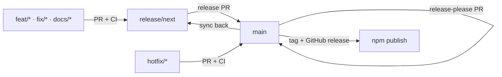

# Branch and release flow

This repository keeps `main` releasable at all times. Work for the next release
is integrated on a long-lived `release/next` branch, so several features can
land reviewably without forcing a release after each merge.



## Day-to-day work

1. Branch from `release/next` (not from `main`):

   ```bash
   git switch release/next
   git pull
   git switch -c feat/short-description
   ```

2. Keep changes focused; use conventional commit subjects (`feat:`, `fix:`,
   `docs:`, `chore:`). release-please derives the version bump and changelog
   from them.
3. Open the pull request against `release/next`. CI runs on every pull request.
4. Merge only when CI is green. Delete the feature branch.

## Cutting the next release

1. Open a pull request from `release/next` to `main`.
2. Review the aggregate diff and the full test matrix.
3. Merge it with a **merge commit**, not a squash, so release-please still sees
   the individual conventional commits.
4. release-please opens its own release PR on `main`. Merging that PR creates
   the tag and GitHub release; the publish workflow then ships the package to
   npm.
5. Fast-forward or merge `main` back into `release/next` so the next cycle
   starts from the released state:

   ```bash
   git switch release/next
   git merge --ff-only main
   git push
   ```

## Test builds (alpha/beta/rc)

Alpha, beta, and release-candidate builds are **not releases**. They are npm
snapshots for testing, and they never change `latest` or create a GitHub
release.

Every push to `release/next` — including a merged pull request — runs the
publish workflow and publishes an automatic beta. The version is the next patch
plus a beta number derived from the workflow run, for example
`3.3.1-beta.123`. `package.json` in the repository is not changed, and npm lets
each version be published only once.

Test it with the Compose setup:

```bash
TODOTXT_MCP_VERSION=next docker compose up -d --force-recreate
# or pin the exact snapshot:
TODOTXT_MCP_VERSION=3.3.1-beta.123 docker compose up -d --force-recreate
```

The package is installed when the container starts, so a new beta needs
`--force-recreate` (or an equivalent recreate) to take effect. Return to the
stable release with `TODOTXT_MCP_VERSION=3.3.0` (or by removing the variable).

For a one-off build from an arbitrary commit, push a manual tag instead:

```bash
git tag prerelease-v3.3.1-beta.1
git push origin prerelease-v3.3.1-beta.1
```

That publishes exactly that version to `next` and does not create a GitHub
release. release-please ignores the `prerelease-v` tag prefix, so stable
version history is unaffected. Delete the tag if you no longer need it; the npm
version remains available.

## Hotfixes

Hotfixes must reach users without waiting for the next release:

1. Branch from `main`: `git switch -c fix/short-description main`.
2. Open the pull request against `main`.
3. After it is merged and released, merge `main` into `release/next`.

## Notes

- `main` is protected ground: only release PRs, hotfixes, and release-please
  land there.
- `release/next` may be recreated after a release; the name is intentionally
  versionless so the flow does not change for every minor release.
- Update this document if the workflow changes.
